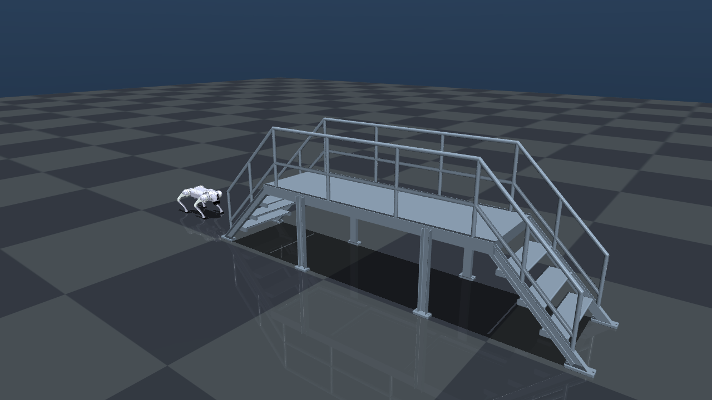

# Unitree Go2 楼梯强化学习项目

基于 MuJoCo 的 Unitree Go2 四足机器人楼梯运动研究项目。最终目标是让机器狗在仿真中稳定完成连续上行、平台通过和下行，再逐步迁移到真实 Go2。

当前属于**阶段 0：可重复实时仿真基线**。场景中只有官方 Go2 和完整钢梯；一键入口会依次完成：

```text
稳定站立 -> 平地 Trot 接近钢梯 -> 楼梯前停稳站立
```

窗口和物理仿真会继续运行，不重播、不重置、不自动关闭。当前**尚未实现上楼梯**。



## 一键实时运行

```powershell
cd D:\桌面\机器狗; D:\Python313\python.exe .\run_demo.py
```

环境依赖记录在 `requirements-static.txt`。当前机器直接使用全局 Python，不需要创建或激活虚拟环境。关闭 3D 窗口或按 `Ctrl+C` 结束。

无窗口回归验证：

```powershell
cd D:\桌面\机器狗; D:\Python313\python.exe .\run_demo.py --headless --duration 11
```

## 当前已完成

- 官方 Unitree Go2 MJCF，`nq/nv/nu = 19/18/12`。
- 完整钢梯 STL 视觉模型，STL 不参与碰撞。
- 49 个分类 box 碰撞体：7 个薄落脚面、支撑柱、侧梁、横撑和栏杆。
- 平地 PD 站立基线、开环 Trot 基线、0.08 m 单级台阶课程场景。
- 单进程实时 3D 演示；运动结束后机器狗在楼梯前持续站立。
- 环境检查、楼梯几何提取、碰撞与初始接触回归脚本。

## 目录

```text
机器狗/
├─ run_demo.py                    唯一用户级实时仿真入口
├─ models/
│  ├─ unitree_go2/                唯一的官方 Go2 MJCF、OBJ 和许可证
│  └─ stairs/                     原始钢梯 STL、几何 JSON 和来源说明
├─ simulations/mujoco/
│  ├─ go2_stairs_static/          完整钢梯场景、单级台阶场景和预览图
│  └─ go2_stand_flat/             PD 站立、开环 Trot 控制基线
├─ scripts/                       环境检查、几何提取和碰撞场景验证
├─ reinforcement_learning/       后续 Gymnasium 环境、训练配置与测试
├─ datasets/                      后续地形与轨迹数据
├─ experiments/                   训练运行、检查点和评测报告
└─ docs/                          路线图、环境、几何、决策与待确认事项
```

`schema` 说明：`models/` 保存不可随意修改的原始资产；`simulations/` 保存场景和控制实验；根目录 `run_demo.py` 只负责展示，不承担训练逻辑。

## 验证

```powershell
D:\Python313\python.exe .\scripts\check_environment.py
D:\Python313\python.exe .\scripts\validate_collision_scenes.py
D:\Python313\python.exe .\scripts\analyze_stairs_geometry.py
```

- `check_environment.py`：依赖、根模型资产、场景编译、关键帧和视觉碰撞开关。
- `validate_collision_scenes.py`：49 个碰撞体、7 个落脚面、真实缝隙、平台净空、单级台阶短时接触。
- `analyze_stairs_geometry.py`：从 STL 重建 `models/stairs/geometry_estimate.json`。

## 后续强化学习路线

1. **Gymnasium 环境**：12 维关节动作，固定控制频率，建立随机动作和站立动作自检。
2. **平地闭环**：速度跟踪、姿态稳定、动作平滑和多种子评测。
3. **单级低台阶**：先 0.08 m，再提升到 0.12～0.15 m。
4. **完整钢梯课程**：平地 → 小坡 → 单级 → 多级 → 缩放楼梯 → 上行 → 平台 → 下行。
5. **域随机化**：摩擦、质量、质心、电机强度、控制延迟和传感器噪声。
6. **统一评测与真机准备**：成功率、完成时间、跌倒率、足端滑移、能耗和关节跟踪误差。

详细阶段、验收标准和风险见 [项目计划](docs/PROJECT_PLAN.md)，学习顺序见 [强化学习学习路线](docs/LEARNING_ROADMAP.md)。

## 模型与来源

- Go2 MJCF 原始说明与许可证：`models/unitree_go2/README.md`、`models/unitree_go2/LICENSE`（BSD-3-Clause）。
- 钢梯 STL 为用户提供的原始几何，保存在 `models/stairs/steel_stair.STL`；派生尺寸和哈希见 `models/stairs/geometry_estimate.json`。
- 不在场景目录重复保存 OBJ/STL。修改路径时只改 `simulations/mujoco/*/scene*.xml`，不要修改官方模型资产。
