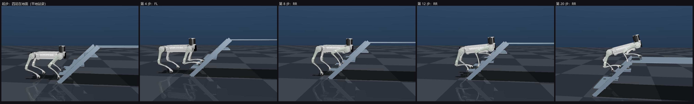

# B2 爬上平台：交替跟进步态 14 步全程走通

> 场景：钢梯 级高 0.197 / 踏面 0.272 / 宽 0.81 m，顶部是 2 m 深平台（后沿 x=1.0326、顶 0.788 m）。
> 机器人：B2 官方 MJCF（69.003 kg，200/200/320 N·m），μ=1.0，50 Hz 纯关节 PD（kp/kd 800/20）+ 重力前馈
> + 机身位姿伺服 k=1.2。
> 代码：`experiments/b2/b2_follow_gait.py`　·　复现：`D:\Python313\python.exe .\experiments\b2\b2_follow_gait.py`
> 数据：`experiments/b2/b2_follow_gait.{txt,json}`　·　3D 演示：加 `--view`（0.5 倍速，读缓存秒开）



## 1. 结论

| 问题 | 实测答案 |
| --- | --- |
| 能爬上平台吗 | **能**。14 步全部走通，全程未失稳；机身 0.680 → **1.232 m**（升 55 cm） |
| 四足真的都站到平台上了吗 | **是**。末态读 `data.contact`：FL→`platform` 158 N、FR→`platform` 152 N、RL→`platform` 185 N、RR→`platform` 183 N —— 四个足端全都压在平台这块几何上 |
| 站在平台上稳吗 | **稳**。原地静置 2 s：漂移 Δx −36 / Δy +0 / Δz −27 mm，打滑 15.8 mm，重心余量 181 mm，未倾覆 |
| 关节够不够 | **够**。全程峰值力矩 **59%**（FR_thigh），没有任何饱和 |
| 换一种控制还成立吗 | 同一条轨迹**纯开环只走 1/14 步**（第 2 步就停）；加机身位姿伺服才 14/14 —— 这条轨迹靠的是机身姿态反馈，不是"摆得刚好" |
| 能不能上真机 | 还不能。这是 MuJoCo 里的 Sim2Sim 结果，没有传感器噪声/延迟模型、没有真机标定 |

## 2. 步序（一次只动一条腿，前后足成对汇合）

起步错位姿态 FL 第2级 / FR+RR 第1级 / RL 地面（三个高度，不是四级），之后每个循环四步、四足各上一级：

| 步 | 腿 | 级 | 说明 |
| --- | --- | --- | --- |
| 1-4 | FR / RL / FL / RR | 1→2 / 0→1 / 2→3 / 1→2 | 第 1 循环：FR 与 FL 汇合、RL 与 RR 汇合 |
| 5-8 | FR / RL / FL / RR | 2→3 / 1→2 / 3→4 / 2→3 | 第 2 循环：**FL 上平台** |
| 9-10 | FR / RL | 3→4 / 2→3 | 第 3 循环：**FR 上平台**（两只前足都到位） |
| 11-12 | FL / FR | 平台上各前移 0.29 m | **在平地上把站立跨距撑开**（见 §3） |
| 13-14 | RR / RL | 3→4 / 3→4 | 两只后足上平台 |

全程**不出现"四足同踩一级"**（B2 髋距 0.657 m > 踏面 0.272 m，那个姿态站不住），始终是前后成对错开一级。

## 3. 关键改动：为什么需要"前足先在平台上迈一步"

上平台段的支撑三角形是"前面两只足 + 后面一只足"，而三只支撑足**全在同一个水平面**时，
三角形的内切圆半径就是重心余量的上限。前足刚上来时前后足跨距只有 0.188 m（= 一级踏面），
内切圆仅 **72 mm** —— 实测就是在这个余量下绕 FL–RR 对角线翻了下去。

按用户提的办法：两只前足都上平台后，先在**平地**上各向前迈一步（0.29 m 的平踏步，余量 117/137 mm，最容易），
把前后足跨距从 0.188 撑到 **0.40 m**，最后一拍的余量从 72 抬到 **108 mm**、落定 181 mm。
这两步完全在平台上，不改变前面已经跑通的爬梯段。

另外两处必要修正：

- **抬脚离目标从 3 cm 加到 6 cm**。原来抬 FR（2→3）时足底离三级踏面只剩 3.3 cm，而 PD 静置要沉 2.7 cm，
  实测足端扫到三级前沿（39–308 N），跟着侧滑失稳。
- **后足在平台上的落点从"离后沿 4.2 cm"改成 12 cm**。贴边时落地后被机身拖动 1.5 cm 就滑出后沿、变成悬空
  （z 0.766、受力 0 N），整机只剩对角两足支撑然后侧翻 —— 证据见
  `experiments/b2/b2_follow_gait_trace_rr_off_edge.txt`。

## 4. 实测逐步数据

| 步 | 抬脚高度 | 机身下沉 | 打滑 | 力矩峰值 | 倾角 | 支撑腿最小力 | 四足所在级 |
| --- | --- | --- | --- | --- | --- | --- | --- |
| 抬FR | 229 mm | +12 | 28.7 | 38% | 8° | 55 N | FL2 FR2 RL0 RR1 |
| 抬RL | 229 mm | +12 | 26.0 | 40% | 11° | 51 N | FL2 FR2 RL1 RR1 |
| 抬FL | 273 mm | +12 | 4.5 | 32% | 20° | 128 N | FL3 FR2 RL1 RR1 |
| 抬RR | 271 mm | +12 | 7.6 | 26% | 20° | 110 N | FL3 FR2 RL1 RR2 |
| 抬FR | 212 mm | +14 | 35.9 | 48% | 20° | 32 N | FL3 FR3 RL1 RR2 |
| 抬RL | 238 mm | +12 | 20.6 | 39% | 20° | 82 N | FL3 FR3 RL2 RR2 |
| 抬FL | 267 mm | +12 | 4.6 | 32% | 28° | 126 N | FL4 FR3 RL2 RR2 |
| 抬RR | 272 mm | +12 | 6.3 | 34% | 28° | 110 N | FL4 FR3 RL2 RR3 |
| 抬FR | 215 mm | +14 | 29.2 | 48% | 28° | 48 N | FL4 FR4 RL2 RR3 |
| 抬RL | 246 mm | +12 | 18.9 | 39% | 28° | 93 N | FL4 FR4 RL3 RR3 |
| 抬FL | 102 mm | +21 | 5.0 | 43% | 28° | 125 N | FL4 FR4 RL3 RR3（平踏步） |
| 抬FR | 69 mm | +25 | 13.2 | 43% | 28° | 46 N | FL4 FR4 RL3 RR3（平踏步） |
| 抬RR | 277 mm | +11 | 26.9 | 35% | 28° | 83 N | FL4 FR4 RL3 RR4 |
| 抬RL | 275 mm | +13 | 23.6 | 55% | 28° | 0 N※ | **FL4 FR4 RL4 RR4** |

※ 最后一步支撑腿最小力出现过 0 N 的瞬时（四足承力切换的瞬间），但没有失稳。

## 5. 失败档案（都是实测，不是推测）

| 版本 | 结果 | 证据指向的原因 |
| --- | --- | --- |
| 12 步（无平台前移） | 11/12，最后一步失稳 | 抬 RL（3→4）时支撑三角形内切圆只有 72 mm；FL 与 RR 同时卸载到 0 N、只剩 FR 承力 → 绕 FL–RR 对角线翻；峰值力矩仅 98% < 100% 却翻，不是关节不够 |
| 14 步 + 全局改用"最大余量"选姿态 | 2/14，第 3 步就失稳 | 换了 `PITCH_HI`/选择容差后，前 12 步的位姿整体平移 2–4 cm；第 1 步打滑从 28.7 涨到 52.4 mm，误差累积到第 3 步 RR_thigh 151% 后坐翻。**结论：已经跑通的爬梯段一个参数都不要动** |
| 14 步 + 后足贴边（4.2 cm） | 13/14，失败在最后一步的"挪重心"段 | RR 足端滑出平台后沿、悬空 0.766 m / 0 N，整机退化成对角两足支撑后侧翻；时间历程见 trace 文件 |

## 6. 平地起步：20 步全程走通（两段式重规划）

`--no-entry` 是只跑爬梯段的那一版（从标准状态 S0 起步，14/14）。默认是"平地正常站姿起步"，20 步：

- **起点**：四足都在地面、俯仰 0 —— 前足 x +0.185（楼梯鼻端 0.217 之外 3 cm）、后足 x −0.300，
  机身 (−0.115, 0.550)。是"狗正常站在楼梯口"的一帧。
- **入口 6 步**（顺序按两条硬规矩：① 同一级上最多两只脚；② 抬某条腿时剩下三足的三角形要够宽）：
  FR 上第 1 级 → FL 上第 1 级 → **RL 平地到位** → RR 平地前移 → FL 上第 2 级 → RR 上第 1 级。
  实测这 6 步全通（抬脚 54–291 mm、打滑 8–24 mm、力矩 37–56%），走完四足落点与 S0 **计划值**偏差 0.0 mm。
- **两段式重规划（关键）**：入口跑完后读一次**实测**机身位姿与四足实际位置，用它当起点重建整条爬梯段，
  再"不重置"地接着跑（`run_plan(..., reset=False)`）。实测这一步的落点与 S0 目标差 **46 mm** ——
  这就是"计划假设足端在 S0、现实差了 4.6 cm"的来源；按实测重规划之后爬梯段才和现实自洽。
- **实测**：**20/20 步全程未失稳**；机身 0.680 → 1.198 m；末态四足接触读数是
  FL→`platform` 164 N、FR 158 N、RL 178 N、RR 176 N（全在平台上）；静置 2 s 漂移 Δx −31 / Δz −28 mm、
  余量 183 mm、未倾覆。峰值力矩 187%（FL_thigh，中段一个瞬时尖峰，没有导致失稳）。

对比：同一套爬梯计划，**不分段**（照名义 S0 一路跑完）只有 17/20，卡在第 18 步
（左前足平台前移之后抬右前足）；分段重规划后 20/20。三次几何类微调（后足踏面边距 1→3.5/6 cm、
平台大步拆 2×0.26 m、入口后站定 3→6 s）实测都没有改善，已全部回退 —— 问题不在落点，在"走路入场后的实测状态与计划假设不一致"。

**耗时（2026-11-08 修）**：爬梯段的位姿搜索一次要 **384 s**（14 步 × 细网格）。
以前这段是在 `--view` 的入口段走完之后才算的，所以画面里机器狗在梯口站着不动 6–10 分钟，看着像卡死。
现在：① 规划全部移到**开窗口之前**（先在无窗口状态下把入口快跑 1 s 拿到实测状态）；② 爬梯段按"实测状态 + 规划参数指纹"缓存
（`b2_follow_gait_plan_climb.json`），同一状态再来就是**读缓存 0 s**。实测 `--view` **1.4 s 起播**、
20 步实时播完 **93 s**；跑数据也从 13–18 分钟降到 **2 s**（计划和爬梯段都命中缓存）。
`--rebuild` 或改任何规划参数都会让缓存自动失效、重新算一次。

## 7. 完整作业流：平地走近 → 爬梯 → 平台前行（`--demo`）

需求：平地起步 → 自主走到楼梯口并摆到入口基准姿态 → 无缝接 20 步爬梯 → 登顶后恢复站姿、在平台上再走几步。
四段由 `--demo` 串起来，段与段之间不停（跑完一段读实测、不重置接着跑下一段）：

| 阶段 | 步数 | 做法 | 实测 |
|---|---:|---|---|
| ① 平地走近 | 8 | 平地上的四拍走：一次动一条腿、腿落点 = 自己原位 + 0.30，机身锚点 = 上一位姿 + 1/4 步幅（位姿仍由搜索给出，俯仰 ≤10°） | 机身 x −0.715 → **−0.172**（名义 −0.115，落后 57 mm 是 PD 跟踪残差），倾角 5°，峰值 39% |
| ② 入口 | 6 | **按走近后的实测位姿重规划**（落点与名义站姿差 100 mm），目标仍是 S0 | 6/6 步，机身 → 0.358/0.668 pitch 2.5°，四足落点与 S0 差 ≤59 mm |
| ③ 爬梯 | 14 | 与 20 步演示完全同一套代码（按实测再重规划 + 缓存） | 14/14 步，机身 → 1.385/1.199，峰值 128%（FL_thigh） |
| ④ 登顶站直 + 平台前行 | 8 | 停顿 1.5 s → 站直 4 s（仰 9°→0°、z 1.199→1.258）→ 站定 2 s → 平台上四拍走 8 步（步幅 0.26） | 8/8 步，机身 x 1.377 → **1.857**，倾角 ≤19°，峰值 92%；末态四足全在 `platform`（79/195/181/222 N），静置 2 s 漂移 Δx −60 mm、未倾覆 |

总计 **36/36 步、全程未失稳**，峰值力矩 128%（FL_thigh，第 3 段）。耗时：四段计划都缓存后
`--demo` 跑数据 **7 s**、`--demo --view` **2.4 s 起播 + 173 s 播完**。

两个必须知道的取舍（都是实测定出来的，不是拍的）：

1. **平台上的站高比平地站姿低 8 cm**（1.258 = 平台顶 0.788 + 0.470）。站到平地站高的 0.550（即 1.338 m）时
   腿伸展 84%，而爬梯末态带着 5–10 cm 的横向/偏航漂移，三足支撑那一拍没有横向修正余量 —— 实测第一拍就
   前倾 45° 摔倒（峰值 136%）。低 8 cm 后 8/8 步全通。
2. **平地走近段不能用"机身按固定速度平移"**：对称站姿 + 机身每步前移 1/4 步幅时，最后一条腿抬起那拍
   重心会落到支撑三角形外（实测余量 −36 mm、侧翻 48°）。现在让 `solve` 在 ±12 cm 窗口里挑余量够的位姿，
   余量回到 63–113 mm。

## 8. 已知限制

- 纯关节 PD + 一个比例型机身位姿伺服，**没有真正的姿态/力矩闭环**，也没有足端力控；
  同一条轨迹开环只能走 1/14 步，说明这套步态目前强依赖反馈。
- 每步 3 s（挪重心 1.0 + 抬腿 1.5 + 落定 0.5；平地入口段还放慢 1.4 倍），全程 60 s，比真机可接受的速度慢很多。
- 机身只按 pitch 参数化（不滚转），yaw/横向没有闭环；平地起步后残留的 9 cm 横向误差就是这么暴露出来的。
- 姿态是在 2 cm / 3° 网格上搜的；网格再粗（5 cm）规划一样通过，但实跑会从 14/14 掉到 2/4。
- 没有扰动测试（用户已明确不需要）。

## 9. 复现

```
D:\Python313\python.exe .\experiments\b2\b2_follow_gait.py --demo --view   # 完整作业流 3D 连播（36 步，约 173 s）
D:\Python313\python.exe .\experiments\b2\b2_follow_gait.py --demo          # 完整作业流跑数据（约 7 s）
D:\Python313\python.exe .\experiments\b2\b2_follow_gait.py --plan    # 只规划，不跑动力学
D:\Python313\python.exe .\experiments\b2\b2_follow_gait.py           # 平地起步，20 步
D:\Python313\python.exe .\experiments\b2\b2_follow_gait.py --no-entry --rebuild   # 从 S0 起步，14/14
D:\Python313\python.exe .\experiments\b2\b2_follow_gait.py --view    # 3D 实时播放（--slow = 0.5 倍速）
```
