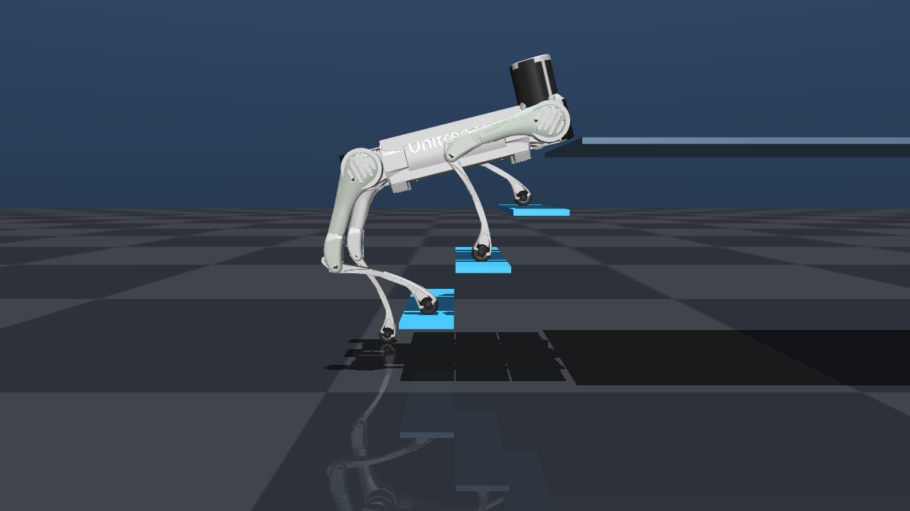
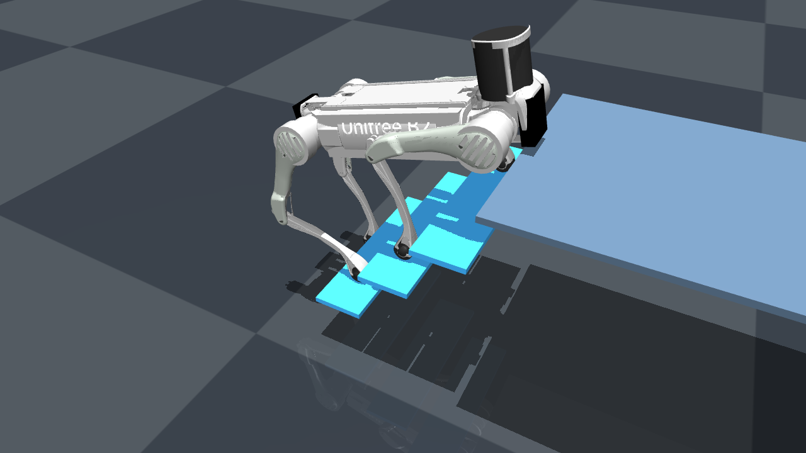

# B2 错位对角姿态：四足分踩第 3/2/1/0 级

> 场景：完整钢梯（0.195 m 高 / 0.18 m 深），B2 官方 MJCF。
> 代码：`experiments/b2/b2_staggered_stance.py`　·　复现：`D:\Python313\python.exe .\experiments\b2\b2_staggered_stance.py --render --step`
> 落点：FL 三级踏面中心 (0.677, +0.192, 0.598)、FR 二级 (0.492, −0.192, 0.412)、
> RR 一级 (0.307, −0.192, 0.227)、RL 地面 (0.120, +0.192, 0.032)。



## 1. 结论

| 问题 | 实测答案 |
| --- | --- |
| 姿态存在吗（12 关节在限位内） | **存在**。pitch 14°、机身 (0.400, 0.468, 0.780)，最小关节余量 0.16 rad |
| 会穿模吗 | **不会**。机身 13.3 cm、机头 2.1 cm、小腿护板 3.9 cm 净空（全部 > 0） |
| 2.5 s PD（kp 800 / kd 20）站得住吗 | **站住**。机身 0.7625 m（指令 0.780，下沉 1.8 cm），峰峰 **1.45 mm**，最大倾角 14.0°（就是设定俯仰） |
| 重心在支撑四边形内吗 | **在**。COM 投影 (0.396, 0.470)，到最近边 **+16.5 cm** |
| 交叉步第一步能迈出去吗 | **能迈、但站不住**。A 组（FL+RR）抬脚后机身从 0.780 塌到 0.530；B 组抬脚后 0.221，整机翻倒 |

一句话：**这个"错位对角"姿态是真的能站住，而且重心余量出奇地大（16.5 cm）；但四足交替换步走不通——
两足对角支撑时重心到支撑线的距离是 9.2 cm，机身会直接塌下去。**

## 2. 姿态与关节（IK 解）

| 腿 | 落点高度 | thigh | calf | 伸展率 |
| --- | --- | --- | --- | --- |
| FL | 三级 0.598 | +1.584 | −2.364 | 38% |
| FR | 二级 0.412 | +1.486 | −1.544 | 72% |
| RL | 地面 0.032 | +0.482 | −0.591 | 96% |
| RR | 一级 0.227 | +0.524 | −1.448 | 75% |

机身 pitch 14°（机头抬起），hip 关节全部 0（落点左右对称，不需要 roll）。
搜索范围：pitch 8–46°、机身 x 0.36–0.56、z 0.46–0.81，四条硬约束
（IK 可达 / 关节余量 >0.10 rad / 三类净空 / 重心在四边形内且余量 >1.5 cm）下共 1042 个可行解，
按重心余量取最优。

> 注意：本姿态之所以能站住，关键是 **RL 落在地面而不是踏面上**——四足在水平面内的投影
> 从"前二后二"变成一个大四边形（x 0.12–0.677），重心几乎落在中间。
> 这也意味着它不是"在楼梯上"的稳定姿态，而是"骑在楼梯上"的姿态。



## 3. 静态平衡

- 2.5 s PD 实测：机身 z 0.7625 m（指令 0.780，下沉 1.8 cm），峰峰 1.45 mm，最大倾角 14.0°，
  **未翻倒**；末态四足足心高度 0.597 / 0.411 / 0.030 / 0.226，与目标 0.598 / 0.412 / 0.032 / 0.227 对得上。
- 足端滑移 25.9 mm：RL 在地面那只有明显的蹭动（地面 μ=0.9、足端 0.4，等效 0.9），
  说明"骑楼梯"姿态里后腿在推、前腿在拉，靠摩擦顶着。
- 重心余量 16.5 cm，是 B2 此前"四足同踩一级"（±3.7 cm）的四倍多——**静态余量不是问题**。

## 4. 对角交叉步（A=FL+RR，B=FR+RL）

| 阶段 | IK | 末态机身 z | 说明 |
| --- | --- | --- | --- |
| 起手 | — | 0.780（实测 0.7625） | 静态稳 |
| A 组：FL→平台、RR→二级 | 成功 | **0.530** | 两足支撑（FR+RL），机身塌 25 cm |
| B 组：FR→三级、RL→一级 | 成功 | **0.221** | 彻底翻倒 |

原因很直接：只剩 FR+RL 两只对角脚时，重心投影 (0.396, 0.470) 到这条对角支撑线的距离是 **9.2 cm**，
而机身没有任何横移能力（本脚本只控制 x/z/pitch，髋 roll 固定 0）。
静态上就已经不在"支撑线"上，抬脚 0.3 s 内就会绕这条线翻下去。

要让它成立，至少需要：①髋 roll 参与、把重心压到对角线上；②允许腾空（trot/跳跃），靠动量过渡。
这两条都超出"纯规则静态步态"的范围。

## 5. 复现

```powershell
cd D:\桌面\机器狗; D:\Python313\python.exe .\experiments\b2\b2_staggered_stance.py --render --step
```

产物：`b2_staggered_{side,iso,front,diag,diag_iso}.png`、`b2_staggered_stance.txt/.json`。

## 6. 已知限制

- 落点是我定的（各级踏面中心 + 地面 0.12 m），换落点会改变姿态与余量；RL 越往后越省腿长、但重心越难压。
- 静态测试没有加扰动（横向推力、斜坡误差），25.9 mm 的足端滑移说明这个姿态对摩擦比较敏感。
- 交叉步只是"抬脚 + 换落点"的开环序列，没有腾空相、没有质心反馈。
