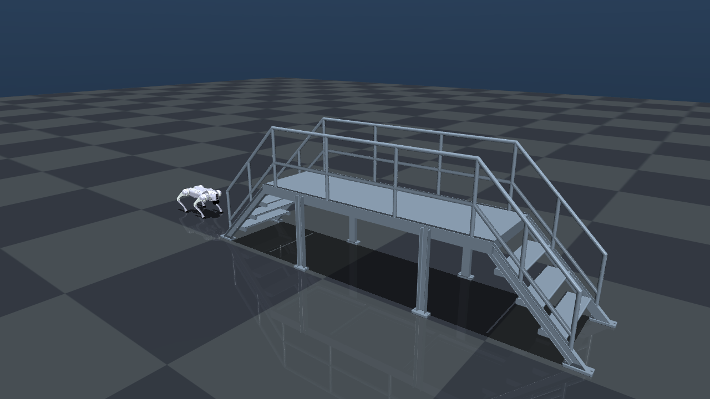

# Go2 + 钢制楼梯 MuJoCo 场景

本目录是当前项目的静态 MuJoCo 场景，自包含 Go2 模型和楼梯资源。

## 当前状态

- 已导入 Unitree Go2 官方 MuJoCo 模型，保留 12 个腿部驱动关节和碰撞体。
- 已将 `steel_stair.STL` 导入同一场景。
- **楼梯已修正为立在地面上的姿态**，长边沿 `+X`，宽度沿 `Y`，高度沿 `Z`。
- Go2 位于低端梯口前，车头朝 `+X`，即朝向上楼方向。
- 现阶段楼梯只显示、不参与碰撞；也没有加入步态或平衡控制器。



## 直接打开

双击：

```text
打开MuJoCo模型.bat
```

或运行：

```powershell
D:\Python313\python.exe "D:\桌面\机器狗\simulations\mujoco\go2_stairs_static\visualize.py"
```

验证模型：

```powershell
D:\Python313\python.exe "D:\桌面\机器狗\simulations\mujoco\go2_stairs_static\validate.py"
```

重新生成预览：

```powershell
D:\Python313\python.exe "D:\桌面\机器狗\simulations\mujoco\go2_stairs_static\render_preview.py"
```

## 导入和合并步骤

1. 从 MuJoCo Menagerie 获取 Unitree Go2 官方模型。
2. 保留 `go2.xml` 和它引用的 16 个 OBJ 文件，并把它们放到本目录的 `assets` 下。
3. 将用户的 `steel_stair.STL` 复制到 `assets`。
4. 在 `scene.xml` 中用 `<mesh>` 注册 STL。文件单位是毫米，所以缩放 `0.001` 转成米。
5. 在 `<worldbody>` 中增加地面、楼梯和一个包含 Go2 的场景；通过 `<include file="go2.xml"/>` 引入机器人。
6. 给楼梯 body 设置立式姿态和贴地高度。
7. 建立 `stairs_home` 关键帧，设置 Go2 的初始位置、朝向和关节姿态。
8. 用 MuJoCo 编译、关键帧复位和 `mj_forward` 检查资源路径、自由度、碰撞和网格世界坐标。

核心场景结构：

```xml
<include file="go2.xml"/>

<asset>
  <mesh name="steel_stair_mesh"
        file="steel_stair.STL"
        scale="0.001 0.001 0.001"/>
</asset>

<worldbody>
  <geom name="floor" type="plane" size="20 20 0.1"/>

  <body name="steel_stair"
        pos="0 0.936 0"
        quat="0.70710678 0.70710678 0 0">
    <geom name="steel_stair_visual"
          type="mesh"
          mesh="steel_stair_mesh"
          contype="0"
          conaffinity="0"/>
  </body>
</worldbody>
```

`quat` 的顺序是 MuJoCo 的 `w x y z`，不是常见的 `x y z w`。这里的四元数表示绕 X 轴旋转 `+90°`；`pos.y=0.936` 将翻转后的宽度方向移到 `y=0..0.936`，此时最低点正好在 `z=0`，楼梯正向立在地面上。

该 STL 在 MuJoCo 编译后的显示轴与普通 STL 查看器不完全一致：最初直接导入时呈侧倒状态，而只修正侧倒后又出现上下颠倒。最终姿态经过正视、侧视和斜视离屏渲染确认，不能只按原始包围盒判断上下方向。

## 关键坐标

- 楼梯世界包围盒：`x=0..4.086866 m`、`y=0..0.936000 m`、`z=0..1.406850 m`
- 楼梯长边：`+X`
- 楼梯宽度中心：`y=0.468 m`
- Go2 初始位置：`(-0.90, 0.468, 0.27)`
- Go2 初始朝向：`+X`
- 初始站姿：官方 `home` 关节位置

## 为什么楼梯暂时不开碰撞

这个 STL 是包含踏步、栏杆和支撑的凹形组合网格。直接把整个网格设为碰撞体时，MuJoCo 使用凸包近似，会把踏步凹槽填平，狗无法正确踩踏。

下一阶段让狗上楼梯时需要：

1. 为每一级踏步和中间平台添加长方体等简化碰撞体。
2. 视需要给栏杆添加碰撞体。
3. 添加 Go2 的站立、步态和越障控制器。
4. 调整摩擦、关节限位和控制频率，再进行上楼测试。

## 模型来源

- Go2：MuJoCo Menagerie `unitree_go2`，BSD-3-Clause，许可证见 `LICENSE_Go2.txt`
- 楼梯：用户提供的 `D:\桌面\steel_stair.STL`

## 说明

官方 `home` 关键帧只是初始关节姿态，不是闭环平衡控制器。如果直接运行 `mj_step`，狗会在重力作用下倒下，这是正常的；当前 `visualize.py` 使用静态刷新模式，方便先检查模型是否成功加入场景。
